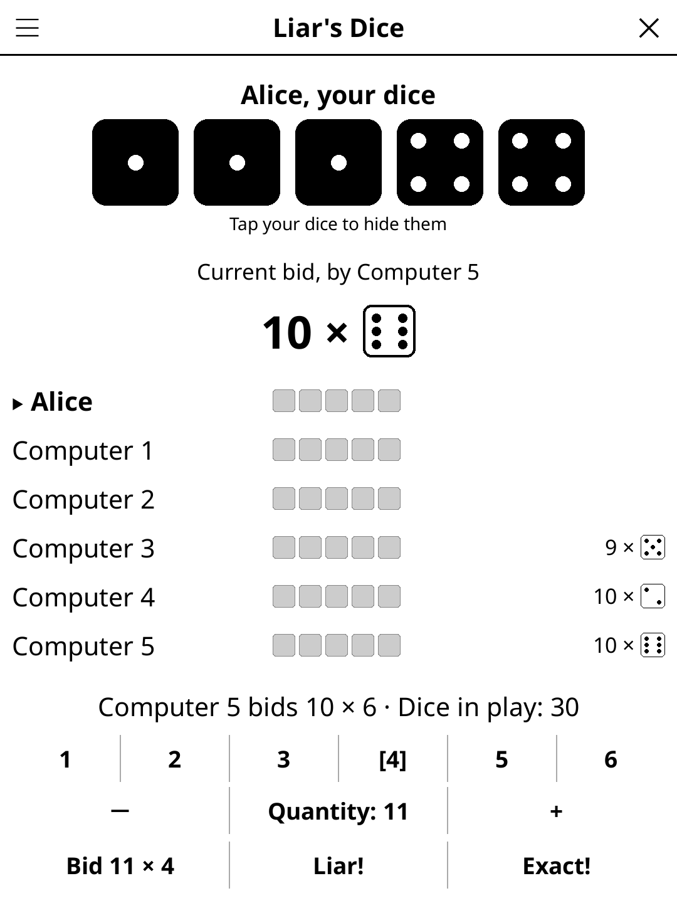

# liarsdice.koplugin

**Liar's Dice** (*Dés menteurs*) is a bluffing dice game for [KOReader](https://github.com/koreader/koreader), for 2 to 6 players: friends sharing one reader, computer opponents, or both.

## Screenshot

## Concept

Everybody has five dice under a cup and sees only their own. Players take turns raising a bid on **all** the dice on the table — "at least four fives" — until someone calls **Liar!** and the cups are lifted.

## Rules

- **Bid** `Q × F`: at least Q dice show face F among all the dice. Each bid must be higher: more dice (any face), or as many dice with a higher face.
- **Liar!**: the dice are counted. Fewer than Q → the bidder loses a die; otherwise the caller does.
- **Exact!** (optional): exactly Q → the caller wins a die back (up to 5); otherwise the caller loses one.
- **Wild ones** (optional, on by default): 1s count as any face. No opening on 1s; from a face to 1s the quantity may be halved (rounded up); from 1s back to a face it must be at least double plus one.
- The player who lost (or won back) a die starts the next round. No dice left: out. Last player standing wins.

## Features

- 1 to 6 human players and 0 to 5 computer players (2 to 6 in all). Computers play on their own, with no hand-over screen; with a single human the game never asks to pass the reader.
- Computer players are simple probabilistic bidders: they weigh their own dice against the odds on the hidden ones, never bid illegally, and call Liar! or Exact! when the numbers say so.
- Dice drawn as vector shapes with real pips, crisp on e-ink. At the reveal, the dice that count for the bid are drawn in black; on your turn, your dice matching the selected face are too.
- Hand-over screen between human players; tap your dice to hide them again.
- Player names typed once and remembered. Interface follows KOReader's language.
- A game in progress is saved; reopening it resumes on the current player's hand-over screen.

## Controls

| Screen | Action |
|---|---|
| Hand-over | Tap **Ready** (or anywhere on the card) |
| Your turn | Face buttons **1–6**, **−** / **+** quantity, **Bid Q × F**, **Liar!**, **Exact!** |
| Reveal | **Next round** |
| Game over | **New game** |
